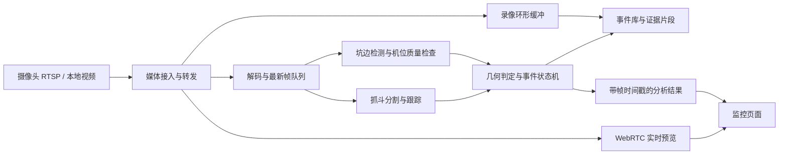

# 抓斗越过坑边缘：需求分析与技术实现方案

| 项 | 说明 |
| --- | --- |
| 文档性质 | 算法与越界业务的设计方案（归档）；不代表已完成现场标定或精度验收 |
| 起草日期 | 2026-09-14 |
| 关联文档 | 管理端能力见 [管理平台功能规格](管理平台功能规格.md)；现行落地说明见 `docs/video-ai.md` |
| 首期场景 | 固定机位画面中，末端抓斗轮廓相对坑边线的临边 / 越界判定 |

## 1. 目标与输入约定

**目标**：实时接入摄像头（或录像），定位末端抓斗、配置坑边边界，判断是否越界，并输出叠加画面、运行状态与可回放告警证据。

**检测对象**：仅末端工作部件（抓斗）；长臂、液压杆、机身不参与越界几何。连接件是否纳入，由标注规范单独约定。

**输入与验收约定**：

- 业务讨论可用示意截图 / 样例录像；**生产训练与精度验收优先使用摄像头或 NVR 原始码流**，不以显示器翻拍、带播放器 UI 的素材作为精度依据。
- 坑边附近常有管道、栏杆、混凝土等相近边缘，且存在遮挡；**不得把图像最强边缘自动当作作业边界**，边界以人工确认 / 发布版本为准。
- 验收规模按 **4 路** 并发设计；先单路打通，再验证多路。机位、协议与现场算力按部署另行确认。

## 2. 首先确定越界的业务含义

| 判定模式 | 输出含义 | 实现前提 |
| --- | --- | --- |
| 画面越界，首版默认 | 抓斗可见轮廓进入图像中指定的坑外区域 | 机位固定、边界可定义、允许图像投影判定 |
| 真实空间越界 | 抓斗某部分越过坑口竖直边界面，或其水平投影超出坑口 | 多视角/深度或机械臂位置数据、统一空间标定 |
| 碰撞风险 | 抓斗距坑壁、管线等障碍物不足安全距离 | 三维几何、目标运动与误差范围，需独立定义 |

画面越界并不等价于真实空间越界。悬空抓斗与坑口不在同一平面，不能用坑口四点单应变换把抓斗像素直接换成真实水平距离。平面映射的适用条件见 [OpenCV 单应变换说明](https://docs.opencv.org/4.x/d9/dab/tutorial_homography.html)。

对只看到一侧坑边的机位，定义“有效线段/折线＋坑内侧＋有效检测区域”，只判断指定可见侧。不能把线段无限延长，也不能声称已监测整圈坑口。完整坑口可见时才使用封闭多边形。

业务还需确定：正常提斗、卸料、跨区转运是否允许越线；若允许，应有明确的作业模式/允许区域及操作记录，不能仅靠轨迹猜测而关闭告警。

## 3. 功能需求

| 模块 | 首版要求 |
| --- | --- |
| 视频接入 | RTSP 摄像头与本地 MP4；连接状态、自动重连、帧超时检测、码流参数 |
| 边界配置 | AI 生成候选边界，人工确认/修正，指定坑内侧、监测范围，保存版本 |
| 抓斗检测 | 末端实例分割；打开、闭合、旋转等姿态；目标 ID 和置信度 |
| 自动分析 | 按时间戳持续分析；正常、临边、越界、不可判定、离线等状态 |
| 实时显示 | 视频叠加抓斗轮廓、坑边线、缓冲区域、告警原因与分析延迟 |
| 告警证据 | 截图、事件前后视频、摄像头/目标/边界/模型版本和时间范围 |
| 运维 | 视频断流、模糊、遮挡、机位移动、推理积压与磁盘容量提示 |
| 历史查询 | 按时间、摄像头和状态检索；标记误报，支持数据回流 |

一期做到显示告警、事件记录；现场声光设备可预留接口。机械停机联锁不在本轮范围内，若需要，应单独制定控制逻辑、失效策略及验证流程。

## 4. 视频链路与系统架构

摄像头优先 RTSP；ONVIF 用于发现设备、读取媒体配置和获取流地址，实际兼容性以型号测试为准。Profile T 涵盖 H.264/H.265 等功能，见 [ONVIF 官方说明](https://www.onvif.org/profiles/profile-t/)。已有 NVR 可从 NVR 拉流；若现场只提供 GB/T 平台接入，再增加对应网关。

建议采用 MediaMTX 转发视频，GStreamer 解码，AI 服务独立运行。MediaMTX 支持多种实时媒体协议、代理和录像，见 [官方介绍](https://mediamtx.org/docs/kickoff/introduction)。协议转发不代表自动完成编解码转换，H.265 的浏览器兼容性应单独验证，必要时转 H.264。

接入实现要点：

1. 局域网先测试 RTSP/TCP；使用小容量最新帧队列，处理不过来丢旧帧，避免延迟持续增长。
2. 记录视频 PTS、接收时间、推理完成时间；跨机事件使用时钟同步。重连建立新的流会话 ID，防止旧结果混入新画面。
3. 重连使用带抖动的指数退避，设置连接和无帧超时。离线必须显式显示，旧“正常”结果不得继续沿用。
4. GStreamer 的 `latency` 和 `drop-on-latency` 可用于控制缓冲，数值通过现场抖动和丢包试验确定，见 [rtspsrc 文档](https://gstreamer.freedesktop.org/documentation/rtsp/rtspsrc.html)。
5. 预览优先 WebRTC；HLS 可用于兼容性回退，但延迟另行标注。AI 初始目标 5–10 FPS，视频预览可保持原始帧率；最终分析频率依据抓斗速度及可接受漏检时间确定。
6. 首版可将结果烧录至对应分析帧后推送，保证画面和轮廓对齐；若使用原始视频＋前端叠加，则必须实现媒体时间映射、有限缓冲和过期结果丢弃，不能把最新框直接画到任意播放帧上。
7. 码流账号通过密钥配置注入，不写入前端、日志和告警 URL。尽量单次向摄像头拉流后在内网分发。

## 5. 抓斗 AI 检测

采用“现场抓斗实例分割＋目标跟踪”。矩形检测框会包含背景和部分机械臂，容易在临边时提前触发；中心点又会漏掉抓斗尖端先出界，因此应以末端轮廓作为主要几何输入。

可用 YOLO 分割模型作基线，输出掩膜、类别和置信度；该任务支持像素级实例轮廓，见 [Ultralytics 分割文档](https://docs.ultralytics.com/tasks/segment)。通用预训练模型不能假定已具备现场抓斗识别能力，必须通过自定义标注、微调和现场测试建立能力。选型时核对实际代码与权重许可，见 [官方许可页面](https://www.ultralytics.com/license)。

训练类别首先设为 `grab_bucket`。按实际需要增加遮挡标记或工作状态，不把全部机械结构合成一个实例。标注可见轮廓，严重遮挡不凭空补画为可信完整轮廓；空洞/相邻液压杆的处理标准保持一致。

跟踪用于稳定目标身份和抑制抖动，不能在完全遮挡时用预测轨迹充当当前检测。掩膜缺失、尺寸异常、轮廓截断或低可信时输出不可判定；已发生的告警保留记录，不能因检测丢失自动清除。

## 6. 坑边缘自动检测

采用“语义识别候选边界＋几何约束＋时间稳定性检查”，不要仅依赖 Canny/Hough 找线。

推荐路径：

1. 数据标注中明确坑口实际边界，区分坑内、地面/平台、坑壁及干扰管线。标记可见边界段及被遮挡区域。
2. 模型预测坑口相关区域及边界候选；结合约定的结构交界提取折线。仅分割暗色坑内区域不足以稳定定位真实坑口。
3. 对可见候选段进行稳健拟合，并检查位置、形状、跨度和与上一有效边界的一致性。弯折坑边用折线，不能强行拟合成直线。
4. 安装阶段由 AI 提议、人工确认；运行时低频复核。固定坑口无需每帧重画，避免边界跟随抓斗遮挡而漂移。
5. 轻微抖动可依据静态背景配准补偿，并记录残差；PTZ 转动、变焦、明显位移或场景变化后使旧边界失效，重新检测和确认。不得无限冻结旧边界。
6. 遮挡期间仅在机位检查有效、未超过配置有效期时沿用边界；不满足条件则进入不可判定。配置值通过回放测试确定。

人工边界作为首阶段基准与失效回退，自动检测作为明确的后续交付项，不能用永久手画代替用户要求的自动识别。SAM 2 可用于交互式标注和掩膜传播辅助，但其提示式分割能力不等于自动识别业务坑边，见 [SAM 2 官方仓库](https://github.com/facebookresearch/sam2)。

## 7. 越界规则与状态机

所有掩膜与边界转换到同一原图坐标系，消除缩放和 letterbox 偏移。多边形配置保存归一化坐标、原始宽高、流配置和版本；分辨率/视场变更需校验。

设抓斗有效掩膜为 B、坑内区域为 P；只在定义好的监测范围内作判断。完整多边形模式定义：

`outside_ratio = area(B ∩ outside(P)) / area(B)`

同时计算边界有符号距离：坑内为正、坑外为负。抓斗轮廓最小距离可用于临边预警；越界使用外侧连通区域面积和最深侵入距离，避免一个噪声像素触发。开放边界模式在每个有效线段邻域内按指定法向区分内外，端点之外不参与判断。

越界比例只能辅助抑制噪声：若业务要求任何尖端出界即报警，就应降低面积门限、提高轮廓质量，并单独验证细小尖端，不能套用较大的比例阈值而漏报。未标定时距离单位只能是像素或图像比例。

推荐状态逻辑：

| 状态 | 触发含义 |
| --- | --- |
| NORMAL | 质量检查通过，抓斗位于坑内且不临边 |
| NEAR_EDGE | 距边界进入预警缓冲带 |
| OUTSIDE_PENDING | 本帧越界证据成立，尚未满足持续时间 |
| OUTSIDE | 越界证据达到时序门限，产生或更新事件 |
| UNKNOWN | 抓斗遮挡/出画、边界无效、画质不足或结果过期 |
| OFFLINE | 无有效视频输入 |

持续时间按帧时间戳计算，允许的帧间隔设上限，断流不能累计为持续越界。演示起点可设 0.3–0.5 秒触发、1 秒稳定回到坑内恢复，这些是待调参数，短于触发时间的越界可能被抑制，需根据业务风险调整。进入和退出阈值使用滞回，避免临界位置闪烁；同一连续事件合并，禁止单纯冷却期掩盖新的独立越界。

状态与事件分开存储：从 OUTSIDE 进入 UNKNOWN 时显示“不可判定，前次越界未确认解除”；目标 ID 重建不应重复创建同一持续告警。

## 8. 服务实现与数据接口

根据后续 Go 与跨平台方向讨论，建议生产架构：Go 管理与规则服务＋Go 推理工作进程（调用 ONNX Runtime）＋MediaMTX＋Web 监控界面；Python/PyTorch 用于离线训练和算法验证，生产运行可不依赖 Python。单机可用 SQLite 与本地证据目录，多路部署再按需要增加 PostgreSQL、对象存储和消息组件。模型先原生验证，满足精度后导出 ONNX，并对导出前后结果作回归。跨平台细节见第 12 节。

建议模块：`ingest`（接入）、`inference`（分割与跟踪）、`boundary`（边界识别/校准）、`rules`（判定）、`events`（证据）、`api`（管理）、`web`（监控）。各路摄像头独立维护队列、边界和状态机，GPU 可调度共享。

拟定接口（尚未实现）：

- `POST /api/cameras`：新增视频源，返回不含密钥的配置。
- `POST /api/cameras/{id}/boundary-proposals`：生成候选坑边。
- `PUT /api/cameras/{id}/boundary`：保存已确认的边界、坑内侧和版本。
- `GET /api/cameras/{id}/status`：流状态、边界有效性、处理 FPS 和结果延迟。
- `WS /api/analysis`：推送时间戳、目标轮廓、状态、判定指标和质量原因。
- `GET /api/events`：查询告警；事件资源按权限读取截图和回放。

分析结果至少包含 `camera_id`、`stream_session_id`、`frame_id`、`media_pts`、接收/完成时间、`track_id`、原图尺寸、轮廓、模型/边界版本、质量标记、状态和原因。事件包含起止时间、首次证据时间、恢复原因、证据路径与人工复核结果。

录像使用按时间或容量受限的环形缓冲，事件保存前后各约 5–10 秒作为起点；按关键帧处理切片，验证回放可解码。存储按实测码率计算：持续录像 4 Mbps 约 43.2 GB/天/路（十进制，不含额外开销），事件保留另行计算。

## 9. 数据与验收

现有三段视频可用于验证回放流程和形成标注规范，不能据此承诺生产精度。起始数据规模可规划为数千张有代表性的标注帧，数量随姿态和场景覆盖调整；重点采样临边、真实越界、快速摆动、打开/闭合、强遮挡、夜间和管线干扰。

训练/验证/测试按完整视频、日期和机位分组，禁止把相邻帧随机分到不同集合。保留不参与调参的独立现场测试集。边界真值和越界事件应由人工逐段复核；无法判明的样本标为不确定，不能强行算作正常。

验收建议先作为待确认目标：

| 指标 | 度量方式与建议 |
| --- | --- |
| 抓斗分割 | 掩膜 IoU、轮廓误差；另统计细小尖端与临边子集 |
| 坑边定位 | 可见边界的像素误差及 P95；单独报告遮挡和机位变化 |
| 越界事件召回 | 按事件计数；初步目标 ≥95%，须约定最短事件时长、容差和覆盖工况 |
| 误报 | 初步目标 ≤1 次/摄像头·小时，报告总测试时长和场景分布 |
| 端到端延迟 | 从可验证采集时间到告警/显示，报告 P50/P95；初步目标 P95 ≤1 秒，含规则等待 |
| 不可判定率 | 单独统计 UNKNOWN 占比和最长时长，不能靠大量拒判取得高准确率 |
| 接入稳定性 | 连续运行测试、断网恢复、错误密码、码流变化、推理过载与存储满 |

这些数值不是已达成结果。发生越界但系统处于 UNKNOWN 的事件，仍应进入端到端漏检/覆盖率统计。分别报告“图像规则真值”与“空间越界真值”，不能混用。

GPU 和摄像头型号在实际分辨率、目标像素大小、解码并发、分析频率及模型基准测试后确定；不预先承诺单卡路数。端到端延迟预算应覆盖采集、缓冲、解码、排队、推理、时序触发和传输。

## 10. 分阶段交付

| 阶段 | 交付内容 | 通过条件 |
| --- | --- | --- |
| A：资料与规则确认 | 视频抽样、抓斗标注范围、边界内外侧、正负事件样例、机位方案 | 业务定义清晰，图像可观测性可接受 |
| B：离线基线 | 现场抓斗分割＋人工基准边界＋越界状态机＋叠加视频与报告 | 能复现标注事件并解释误报/漏报 |
| C：实时闭环 | RTSP 接入、低延迟分析、预览、断流恢复、告警截图/录像 | 单路连续运行及故障恢复通过 |
| D：自动坑边 | 自动候选、人工修正入口、稳定性检查、机位变化失效机制 | 独立数据满足边界和事件验收指标 |
| E：现场试运行 | 多工况数据补充、阈值冻结、多路压测、部署和维护文档 | 按现场约定指标验收 |

作为人力规划起点，单机位演示可按约 2–3 周、现场试运行另按 3–6 周估算，前提是及时提供可用视频、流权限、标注反馈和部署环境；不是承诺工期。真实三维越界需要另做传感与标定方案，不套用以上估算。

下一步优先确定：是否固定机位、摄像头型号/协议、正常作业是否允许越线、报警形式和部署环境。不要提供明文密码；流凭据通过现场配置注入。

## 11. 四路配置落地

首版四路独立作图像越界判定，不依赖四机三维融合。同一抓斗被多个摄像头观察时，各路事件保留来源；现场级事件可按已配置的机位关联和时间窗口聚合，但不能简单把不同视频中的目标 ID 视为同一目标。

| 项目 | 初始配置/估算 |
| --- | --- |
| 输入 | 4 路，优先测试 1080p、H.264、15–25 FPS；以现场目标像素尺寸调整 |
| AI 分析 | 每路 5–10 FPS，总计 20–40 帧/秒，须四路并发实测 |
| 调度 | 每路最新帧队列容量 1–2，公平调度；某一路故障不阻塞其他路 |
| 网络 | 每路若为 4 Mbps，输入合计约 16 Mbps，另计预览、录像和协议开销；建议部署于千兆内网 |
| 连续录像 | 同样按每路 4 Mbps，四路约 172.8 GB/天；7 天约 1.21 TB，需另留容量余量 |
| 计算资源 | 一台具备硬件解码能力的 NVIDIA GPU 主机作为候选；CPU、显存和内存按实际模型测试定型 |
| 画面 | 四宫格总览与单路放大，分别展示流状态、有效边界、抓斗与事件 |

四路压测须同时开启解码、边界复核、抓斗推理、预览和证据录像；报告每路处理 FPS、P95 延迟、过期帧比例和 GPU/CPU/内存占用。至少执行一次四路持续运行 24 小时及单路断流恢复测试。容量不足先优化解码、输入尺寸和模型，降低分析频率前须重新评估快速越界漏检。

## 12. Go 开发与跨平台算法部署

### 推荐分工

Go 负责摄像头管理、四路调度、模型调用、几何规则、事件状态机、API、WebSocket、录像管理和配置；离线 Python/PyTorch 负责数据处理、模型训练、评估与 ONNX 导出。训练语言不约束生产服务语言。

生产建议将推理封装为独立 Go 工作进程，通过本机 gRPC 等接口与主服务通信。这样原生推理库故障可以独立重启，主服务可保持较少的平台依赖。也可在单进程内调用，结构更简单但原生库崩溃会影响整个服务。

MediaMTX 负责 RTSP 转发与浏览器播放；它提供 Linux、Windows、macOS 独立可执行程序，见 [官方介绍](https://mediamtx.org/docs/kickoff/introduction)。AI 解码采用平台打包的 FFmpeg 子进程或 GStreamer 管道；接收到 RTSP 数据包不等于已得到可推理像素，解码仍有原生依赖。首版选择一种解码实现，不同时维护两套。

可先用 FFmpeg 子进程降低 Go 主程序的链接复杂度；接口需明确像素格式、尺寸、完整帧长度和时间戳。裸 RGB 管道不自带 PTS，不能直接当作已完成时间同步；生产需增加帧元数据通道、携带时间戳的传输或采用解码库接口。不得每帧启动一次 FFmpeg。

### 推理实现

候选 Go 封装为社区项目 `github.com/yalue/onnxruntime_go`，底层使用 ONNX Runtime C API，要求 cgo 和匹配的动态库，见 [项目说明](https://github.com/yalue/onnxruntime_go)。它不是微软官方 Go SDK。需固定 Go 封装、C API 头文件、运行库、执行后端和模型版本。

完整算法链路：

1. 解码帧 → 缩放/补边 → RGB 转换、归一化和模型要求的张量布局。
2. `grab_bucket.onnx` 输出抓斗实例；按实际导出张量执行置信度过滤、必要的 NMS、掩膜重建和轮廓提取。不能假定所有 YOLO 版本的输出相同或都需要 NMS。
3. `pit_boundary.onnx` 输出坑边相关语义/边界；提取、拟合并校验候选折线。固定机位低频运行，结合已确认边界和失效检测。
4. 逆变换回原图坐标，Go 计算距离、外侧连通区域和时序状态，产生事件。
5. 导出包附带输入尺寸、颜色顺序、归一化、输出语义、类别、opset、版本和校验和；Go 与 Python 对同一组图像执行数值/轮廓/事件一致性测试。

几何计算、规则和轻量跟踪可以用 Go 实现；神经网络算子交由原生推理引擎执行。无需把模型训练代码或卷积计算重写为 Go。GoCV 可用于图像处理，但引入 OpenCV 安装依赖，应在确实需要时使用，见 [GoCV 安装文档](https://gocv.io/getting-started/)。

### 平台适配

| 目标平台 | 基线 | 可选加速 | 发布注意事项 |
| --- | --- | --- | --- |
| Linux x86_64 | ONNX Runtime CPU | NVIDIA CUDA，后续评估 TensorRT | 对齐驱动、CUDA、运行库及系统 ABI |
| Windows x86_64 | ONNX Runtime CPU | NVIDIA CUDA 或 DirectML | 配套 DLL 和运行依赖；验证 Go 封装对应后端 |
| macOS Apple Silicon | ONNX Runtime CPU | CoreML | 使用 arm64 库，验证算子支持和 CPU 回退 |
| Linux ARM64 | 对应架构 CPU 包 | 依实际设备 SDK/后端 | 不能把普通 ARM 主机与 Jetson 的能力视为相同 |

ONNX Runtime 通过 Execution Provider 接入不同硬件，见 [执行后端文档](https://onnxruntime.ai/docs/execution-providers/) 和 [CoreML 文档](https://onnxruntime.ai/docs/execution-providers/CoreML-ExecutionProvider.html)。后端存在不支持的算子、部分 CPU 回退和数值差异；同一 ONNX 文件不保证各平台相同性能。启动时记录实际后端并运行自检，GPU 不可用时按配置拒绝启动或显式降级，不能静默以低帧率运行。

“跨平台”交付为同一套业务代码、各平台独立安装包，不是一个二进制在所有系统通用。包内包含 Go 服务/工作进程、媒体程序、模型、匹配的原生运行库和配置。cgo 工作进程在对应操作系统/架构 CI 中编译验证，不能仅设置 GOOS/GOARCH 就视为适配完成。Docker 可简化 Linux 服务发布，不作为 macOS/Windows 原生 GPU 能力的统一替代。

### 四路性能策略与验证顺序

每路保留独立的最新帧队列和状态；共享有限推理会话池，禁止每帧加载模型。复用缓冲区，明确所有权，不并发覆写同一张量。初始小批或单帧公平调度，批处理只有在实测改善吞吐且满足延迟预算时启用。

四路每路 10 FPS 意味着抓斗推理总需求 40 FPS；若串行每帧 25 ms，已耗尽单队列时间预算，尚未计入边界检测和其他处理，因此必须留裕量。该计算是容量说明，不是已测性能。

先验证 Python 模型精度，再验证 Go＋CPU 的一致性，随后在选定生产平台启用 GPU 并作四路压测，最后完成其他平台的回放、事件一致性和性能验收。初期可用 Python 算法服务加速模型迭代，稳定后通过同一结果接口替换为 Go＋ONNX 工作进程。
